<!-- ═════════════ HERO ═════════════ -->

<!-- ═════════════ HELLO ═════════════ -->
## ✦ Hello, I'm GG.

> **Offensive security researcher** specializing in APT simulation, exploit development and evasion.
> I architect enterprise-grade security tooling and push **AI-orchestrated offensive operations** —
> creator of [**RedPilot**](https://github.com/geevarghesekthomas84-sys/redpilot) and [**Gria-AI**](https://github.com/geevarghesekthomas84-sys/Gria-AI).
>
> `authorized testing only` — tools and research for red teams, bug bounty and defenders.

<table>
<tr>
<td width="50%" valign="top">

**▍FOCUS — side A**

| | |
|:--|:--|
| `A1` | **Red team ops** — APT simulation · exploit dev · evasion |
| `A2` | **AI + offensive security** — AI-orchestrated recon & attack sim |
| `A3` | **On-device AI** — Android · Kotlin · local LLMs |
| `A4` | **Cloud + DFIR** — cloud security · digital forensics |

</td>
<td width="50%" valign="top">

**▍BY THE NUMBERS**

| | |
|--:|:--|
| **6+** | tools built |
| **1100+** | lines in CyberForge |
| **40+** | tok/s on-device AI |
| **50+** | detection rules |

</td>
</tr>
</table>

<!-- ═════════════ PROJECTS ═════════════ -->
## ✦ Projects

<table>
<tr>
<td colspan="2" valign="top">

### `01` 🎯 [RedPilot](https://github.com/geevarghesekthomas84-sys/redpilot) &nbsp;★ FLAGSHIP
Point it at a target and it runs the engagement — the AI plans recon, RedPilot runs the tools on your box, and you get findings plus a written assessment. **Discovery → validation → remediation → report**, drivable from **CLI · HTTP API · MCP · dashboard**.
   

</td>
</tr>
<tr>
<td width="50%" valign="top">

### `02` 📱 [Gria-AI](https://github.com/geevarghesekthomas84-sys/Gria-AI)
Private Android AI chat app powered by local LLMs — on-device Gemma at ~40 tok/s, voice input, biometric vault, live hardware telemetry.
  

</td>
<td width="50%" valign="top">

### `03` 🛠️ [CyberForge](https://github.com/geevarghesekthomas84-sys/geevarghesekthomas84-sys/blob/main/gists/cyberforge.py)
1,100-line zero-dependency security Swiss army knife — hash cracking, encoding, XOR, password auditing, forensics, log analysis, integrity monitoring.
  

</td>
</tr>
<tr>
<td width="50%" valign="top">

### `04` 🗡️ [Recon Blade](https://github.com/geevarghesekthomas84-sys/geevarghesekthomas84-sys/blob/main/gists/recon_blade.py)
All-in-one recon multi-tool — ports, HTTP headers, subdomains, DNS, WHOIS and tech fingerprinting with HTML reports.
  

</td>
<td width="50%" valign="top">

### `05` 🛡️ [Insider Threat SOC Lab](https://github.com/geevarghesekthomas84-sys/insider-threat-detection-lab)
Blue Team lab simulating a privileged data breach — Wazuh, Splunk and ELK with 50+ detection rules mapped to MITRE ATT&CK.
  

</td>
</tr>
<tr>
<td width="50%" valign="top">

### `06` 👻 [GhostKit](https://github.com/geevarghesekthomas84-sys/GhostKit)
Drop-and-run USB toolkit — AI-assisted Nmap auditing, Nuclei scanning, packet analysis and an offline AI security assistant.
  

</td>
<td width="50%" valign="top">

### `07` 🌐 [NetPulse](https://netpulse.itgg.space)
Browser-based protocol visualizer and Packet Tracer-style simulator — 39 protocols, IOS-style CLI, OSPF/RIP/BGP, 20 labs, 6 languages.
  

</td>
</tr>
<tr>
<td width="50%" valign="top">

### `08` 🐬 [Flipper Zero Workshop](https://flipper.itgg.space)
Take a Flipper Zero apart in 3D and learn how it works across 50 interactive lessons.
  

</td>
<td width="50%" valign="top">

### `09` 🍓 [Raspberry Pi 5 Workshop](https://rpi5.itgg.space)
Wire real parts to a 3D Pi 5, run real Python with gpiozero and build 9 projects in 50 lessons.
  

</td>
</tr>
<tr>
<td width="50%" valign="top">

### `10` 📡 [ESP32 Workshop](https://esp32.itgg.space)
Microcontrollers, sensors, displays, motors, wireless and IoT security — each lesson in a 3D ESP32 workspace.
  

</td>
<td width="50%" valign="top">

### `11` 🎨 [Material Atlas](https://material.itgg.space)
Search Material Icons, Material Symbols and original SVGs, compare styles and download SVG or PNG.
  

</td>
</tr>
</table>

<a href="https://itgg.space/library.html"><b>→ see all 22 projects in the library</b></a>

<!-- ═════════════ SKILLS & TOOLKIT ═════════════ -->
## ✦ Skills & toolkit

  

<!-- ═════════════ CERTS ═════════════ -->
## ✦ Certs — proof of work

| | Credential | Issuer | Issued | |
|:-:|:--|:--|:--|:--|
| 🟦 | **Certified Blue Team Fundamentals (BTF)** | CyberWarFare Labs | Nov 2026 | `BTF-6b0a5d9748939fd2c6c0017b` |
| 🟩 | **Advent of Cyber 2022** | TryHackMe | Dec 2024 | [`THM-S1MSB41YDW` ↗](https://tryhackme-certificates.s3-eu-west-1.amazonaws.com/THM-S1MSB41YDW.pdf) |
| 🟥 | **Linux 100: Fundamentals** | TCM Security | Nov 2024 | `cert_fnvbhsx9` |
| 🟪 | **Full Ethical Hacking Course** | Udemy | Jun 2023 | Kali Linux · Network Security |

<!-- ═════════════ STATS ═════════════ -->
## ✦ Telemetry

  
  
    
  

<!-- ═════════════ CONTACT ═════════════ -->
## ✦ Let's talk

<!-- ═════════════ FOOTER ═════════════ -->

